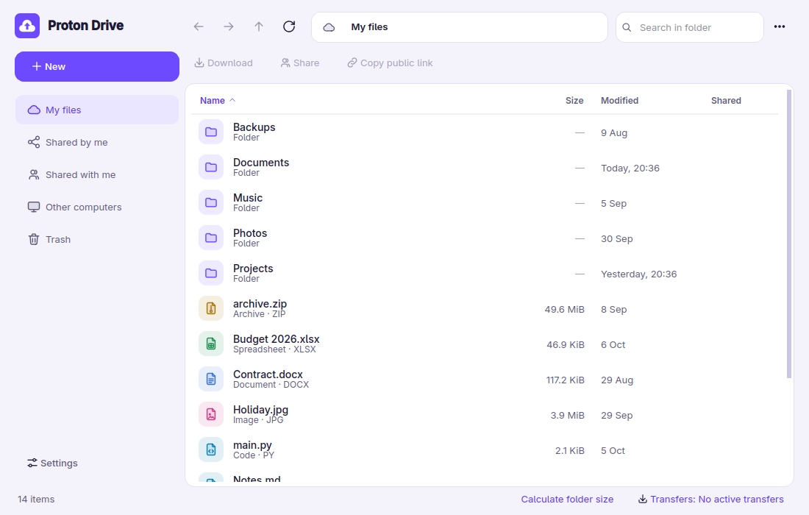
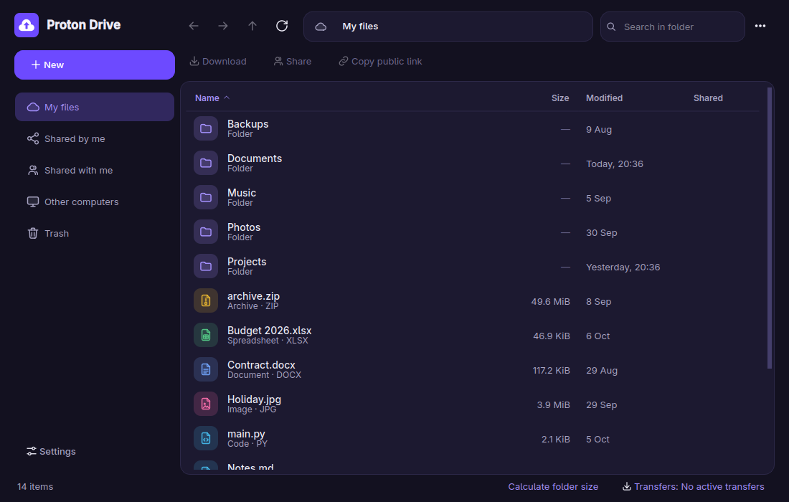
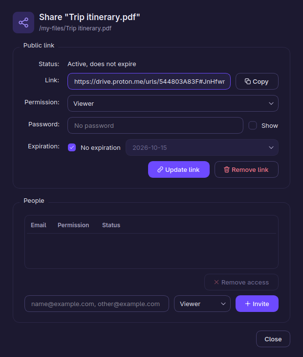

# pdrive – Unofficial Proton Drive for Linux

A graphical file manager (Qt), a Dolphin context menu and a command-line tool, all built on top of the
official `proton-drive` CLI.

> **Unofficial project.** Not affiliated with or endorsed by Proton AG. "Proton" and "Proton Drive" are
> trademarks of their respective owners. pdrive does not contain or redistribute Proton's CLI, and it
> never sees your credentials: sign-in is handled by the official CLI, which stores the session in your
> system keyring.

<p align="center">
  
  
</p>

*The screenshots use a simulated drive with made-up files.*

## Features

- **File manager window**: browse My files, Shared by me, Shared with me, other computers and the Trash,
  with breadcrumbs, instant search and sortable columns.
- **Fast navigation**: persistent CLI sessions, an in-memory folder cache and background prefetching of
  subfolders, so visited folders open instantly.
- **Transfers**: drag and drop files from your file manager to upload; paste to upload; queue with two
  parallel transfers and conflict handling (replace / keep both / skip).
- **File operations**: new folder, rename, copy, cut, paste, move to Trash, restore, delete permanently.
- **Sharing**: public links with role, password and expiration; invite people by email; remove access.
- **Own look**: custom light and dark themes that follow the system, with its own icon set.
- **Dolphin integration** (KDE): right-click → *Proton Drive* to upload, upload to…, copy a public link,
  share with… or open the explorer.
- **CLI**: `pdrive upload`, `download`, `link`, `share`, `ls`… for scripts.

<p align="center">
  
</p>

## Compatibility

| Component | Requirement | Status |
|---|---|---|
| System | Linux x86-64 with the official Proton Drive CLI | Tested **only on Fedora 44 + KDE Plasma 6 (Wayland)** |
| Python | 3.11 or newer (uses `tomllib`) | Tested with 3.14 |
| GUI | PySide6 (Qt 6) | Works on any desktop; tested on Plasma |
| Session storage | `libsecret` (GNOME Keyring or KWallet), required by the official CLI | — |
| Context menu | Dolphin on Plasma 6 (KF6 service menus) | KDE only. On GNOME/Nautilus, Thunar, etc. there is no menu, but the window and the CLI work |
| Notifications and dialogs | `notify-send`, `kdialog` (or `zenity`), `wl-copy` (or `xclip`/`xsel`) | Optional, depending on the action |

It should work on other distributions that meet these requirements, but that has not been tested. If you
try it on Ubuntu, Arch, openSUSE…, please open an issue and let me know. Fedora packages:
`sudo dnf install python3-pyside6 kdialog libnotify wl-clipboard`.

## Installation

1. Download the official CLI from <https://proton.me/drive/download> and put it as `proton-drive` in the
   project root (or in `~/.local/bin/proton-drive`).
2. Run:

```sh
./install.sh            # idempotent; safe to re-run over a previous install
pdrive login            # opens your browser; only needed once
pdrive gui              # or "Proton Drive" in your application menu
./install.sh --uninstall
```

`install.sh` installs everything under `$HOME`: `~/.local/bin/{pdrive,proton-drive}`, the Dolphin service
menu (`~/.local/share/kio/servicemenus/pdrive.desktop`), the application launcher
(`~/.local/share/applications/pdrive.desktop`) and the icons. It installs no services or timers.
Uninstalling does not delete `~/.config/pdrive` or any of your data. If `~/.local/bin` is not in your
`PATH`, add it (the Dolphin menu uses absolute paths and does not need it). If the menu does not appear,
restart Dolphin.

## CLI

```
pdrive login | status | ls [remote] | open | gui
pdrive upload FILES... [--to REMOTE] [--conflict rename|replace|skip|revision]
pdrive uploadto FILES...             # dialog to pick the remote folder
pdrive download REMOTE [--to DIR]
pdrive link PATH... [--password P --expiration YYYY-MM-DD]   # local path (uploaded first) or remote
pdrive share PATH... [-e EMAIL] [--role viewer|editor]
pdrive unlink REMOTE...
```

Exit codes: 0 ok, 1 error, 2 not signed in. `PDRIVE_NO_GUI=1` prints notifications to stderr and opens
no dialogs.

## Configuration (`~/.config/pdrive/config.toml`)

```toml
upload_dir = "/my-files/Uploads"
disk_cache = false   # true: keep folder and file names in ~/.cache/pdrive, UNENCRYPTED
```

The folder cache lives in memory only by default. You can enable the on-disk cache in Settings for faster
startup; disabling it deletes the file. `PDRIVE_CONFIG_DIR` changes the config directory and `PDRIVE_BIN`
the `proton-drive` binary used.

## Privacy and safety

- pdrive stores no credentials. The official CLI keeps the session in the system keyring.
- Everything is sent through the official CLI; pdrive makes no network requests of its own.
- Deleting permanently is only possible from the Trash view and always asks for confirmation.
- The optional disk cache is off by default because it stores names of your files unencrypted.

## Known limitations

- The official CLI (v0.9.0) cannot remove public links yet (`sharing remove-url` is "not implemented"); pdrive
  tells you to do it from the web.
- The CLI reports no transfer progress, so transfers show an indeterminate bar, and a running transfer
  cannot be cancelled (queued ones can).
- The interface is in English only for now.
- Rarely, the test suite has shown intermittent problems that could not be traced to a cause (one hang and
  one crash on exit, each seen once or twice in many runs). If you hit a freeze, please open an issue.

## Development

```sh
QT_QPA_PLATFORM=offscreen python3 -m unittest discover tests
```

Tests never touch a real Drive: they run against `tests/fake_proton_drive`, a simulator of the CLI.

```
pdrive/client.py     the only module that runs the proton-drive binary (persistent sessions for reads)
pdrive/config.py     paths and config.toml
pdrive/__main__.py   command-line interface (`pdrive ...`)
pdrive/notify.py     desktop notifications and kdialog/zenity dialogs
pdrive/gui/          Qt interface: window, transfers, dialogs, theme, widgets, folder cache
assets/              application icon and UI icon set
dolphin/, desktop/   Dolphin service menu and application launcher
tests/               unit tests and the CLI simulator
```

## License

MIT — see [LICENSE](LICENSE).
